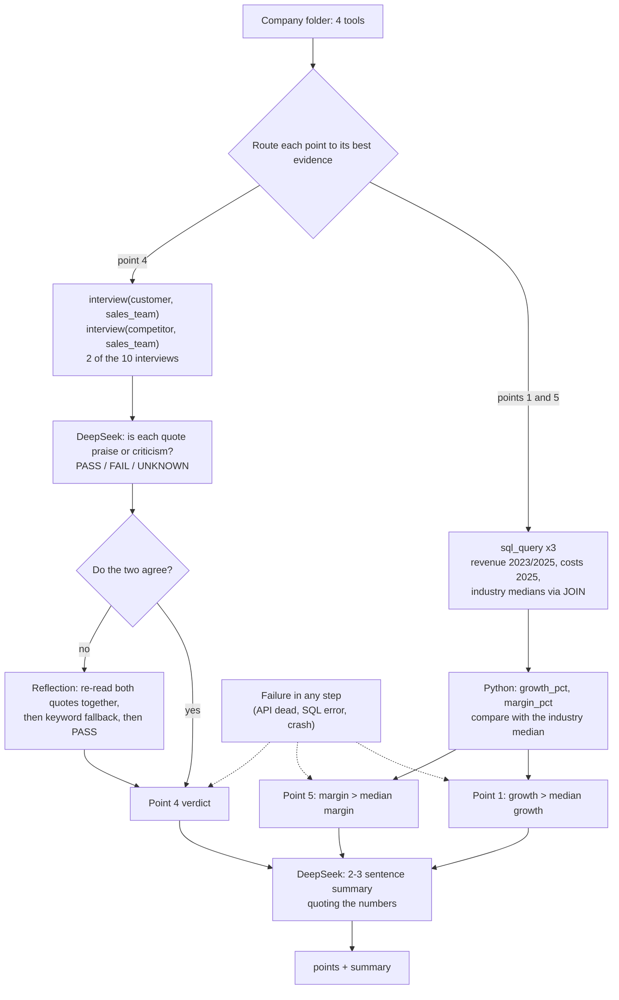

# FTEC5660 Homework 3: Fisher's 15-Point Investment Agent

Build a LangChain agent that researches a company with tools and applies the
framework from Philip Fisher's *Common Stocks and Uncommon Profits* (Part One,
Chapter 3 "What to buy: the fifteen points to look for in a common stock", and
Chapter 4 "What to buy: applying this to your own needs"). You choose 3 of
Fisher's 15 points and decide yourself what PASS means for each. For every
company your agent gives a PASS/FAIL verdict on your 3 points and a short
summary.

The companies are fictional, so the model cannot answer from memory. Unlike a
pile of reports, the evidence is spread over three sources, and your agent has
to go and get it with tools, the way Fisher's "scuttlebutt" method sends an
investor to talk to customers, competitors, suppliers and staff.

## Data and tools

`public_test/` has one folder per company. Your code receives four tools per
company (built by the provided code in `hw3.py`):

| Tool | What it gives you |
| --- | --- |
| `list_documents()` | the company's six documents and their dates |
| `read_document(name)` | one document: the 2025 letter to shareholders, four earnings calls (Q3 2025 to Q2 2026) and a news file (July 2025 to July 2026) |
| `sql_query(query)` | one read-only SQLite query on the company's database; at most 50 rows come back, so use `SUM`, `GROUP BY` and `WHERE` |
| `interview(role, topic)` | what one person says about the company; at most **10 interviews per company** |

The documents are what management says. Management's own claims (such as "we
have never cut research" or "our people are our greatest strength") are not
evidence on their own: check them against the database and the interviews.

**Database tables** (amounts in USD thousands; dates `YYYY-MM-DD`, months
`YYYY-MM`, quarters like `2025Q3`; the fiscal year is the calendar year):

| Table | Columns |
| --- | --- |
| `company` | name, industry |
| `industry_medians` | industry, revenue_growth_2y_pct, new_product_share_pct, new_product_sales_per_rd, operating_margin_pct (one row per industry; use the row for the company's own industry) |
| `orders` | order_id, order_date, product, customer, amount, note (about 3,000 to 4,000 orders from January 2023 to June 2026; revenue is the sum of order amounts) |
| `products` | product, launch_date |
| `monthly_costs` | month, cost_of_sales, selling_admin, research_development |
| `quarterly_cash` | quarter, operating_cash_flow, capex, cash_end |
| `capex_plan` | year, planned_capex (2026 to 2028) |
| `returns` | month, units_shipped, units_returned |
| `insider_trades` | trade_date, person, title, side (`buy` or `sell`), shares, price |

**Terms used in the data.**

| Term | Meaning |
| --- | --- |
| FY2025 | Fiscal year 2025. Here the fiscal year is the calendar year, so FY2025 is January to December 2025. |
| Quarter | Three months of the year: Q1 is January to March, Q2 April to June, Q3 July to September and Q4 October to December. The database writes `2025Q3`; the documents write "third quarter 2025". |
| Amounts | The database is in **USD thousands** (676,100 means US$676.1 million). The documents use USD millions. |
| Revenue | Money from sales: the sum of `amount` in `orders`. |
| Cost of sales | The cost of making the products that were sold. |
| Selling and admin | The cost of selling and of running the company (sales staff, offices, management). |
| R&D | Research and development spending, mainly on new products. |
| Operating margin | Operating profit as a share of revenue: (revenue − cost of sales − selling and admin − R&D) ÷ revenue. |
| Operating cash flow | Cash that the day-to-day business brings in during a quarter. |
| Cash at the end of a quarter | The cash the company holds on the last day of that quarter (`cash_end`). |
| Capex | Capital expenditure: spending on factories, machines and other long-term assets. `capex_plan` holds the planned capex for 2026 to 2028. |
| Return rate | Units returned ÷ units shipped, from the `returns` table. |
| Industry median | The middle value for companies in the same industry, from `industry_medians`. |
| Insider | A director or senior manager of the company. `insider_trades` lists the shares they bought (`buy`) or sold (`sell`). |
| Earnings call | A meeting each quarter where management presents the quarter's results to investors. Each call quotes that quarter's revenue. |

**Interviews.** Roles: `customer`, `current_employee`, `former_employee`,
`competitor`, `supplier`. Topics: `sales_team`, `working_conditions`,
`top_management`, `decision_making`, `competitive_edge`. Only some people know
about each topic; the others say they can't comment, and that answer still
uses up one interview.

| Topic | Who knows about it |
| --- | --- |
| `sales_team` | customer, competitor |
| `working_conditions` | current_employee, former_employee |
| `top_management` | former_employee, supplier |
| `decision_making` | supplier, customer |
| `competitive_edge` | competitor, customer |

People who know about a topic always agree with each other, so one good answer
is enough.

## Choose your 3 points and your rules

Pick any 3 of Fisher's 15 points and write them in `CHOSEN_POINTS` near the
top of `hw3.py`, e.g. `CHOSEN_POINTS = [1, 7, 15]`. The full questions are in
`FISHER_POINTS` in `hw3.py` and in the book.

| # | Fisher's point | Where the evidence is |
| --- | --- | --- |
| 1 | Market potential for sales growth | database |
| 2 | New products as current lines mature | database |
| 3 | Effective research and development | database |
| 4 | Above-average sales organization | interviews (`sales_team`) |
| 5 | Worthwhile profit margin | database |
| 6 | Maintaining or improving margins | database |
| 7 | Labour and personnel relations | interviews (`working_conditions`) |
| 8 | Executive relations | interviews (`top_management`) |
| 9 | Depth of management | interviews (`decision_making`) |
| 10 | Cost analysis and accounting controls | earnings calls, checked against the database |
| 11 | Advantage over competitors | interviews (`competitive_edge`) |
| 12 | Long-range outlook on profits | database |
| 13 | Growth without dilutive equity financing | database |
| 14 | Management talks freely about troubles | earnings calls, checked against the database |
| 15 | Management of unquestionable integrity | news file, checked against the database |

For each of your points, **you design the rule**: which evidence to use, what
to compute or whom to ask, and where the line between PASS and FAIL lies. PASS
means the company looks favourable on that point, as Fisher would see it.

We grade your verdicts against our own answer key. It uses one fixed rule per
point, which we do not publish, and the data never puts a company close to
the line of that rule, so a sensible reading of Fisher usually gives the same
answer. **Test your rules on the public answers**:
`public_test/ground_truth.json` gives the expected verdict on all 15 points
for each of the 20 public companies, and every point fails in 6 of them. If
your rule disagrees with the public answers, rethink it.

**Tip: calculate with tools, not in your head.** Do every sum, ratio and
comparison in SQL or Python, including the number of days between two dates
(SQLite's `julianday()` gives a date as a number of days).

## Student task

Fill in the three places in `hw3.py` marked `### YOUR CODE HERE`. You may add
imports, constants and helper functions above them, but do not change the
provided code below them:

- `CHOSEN_POINTS` lists your 3 points.
- `build_agent()` creates your model and anything else you need once.
- `analyze_companies(agent, companies)` receives
  `{company_folder: [list_documents, read_document, sql_query, interview]}`
  and returns, for every company,
  `{"points": {1: "PASS", 7: "FAIL", 15: "PASS"}, "summary": "..."}` (here with
  `CHOSEN_POINTS = [1, 7, 15]`).

Use the course techniques that fit your points: tool use for the database and
the interviews, planning which interviews to spend, routing each point to the
right source, prompt chaining, parallel calls, reflection to check your
answers, or a combination. Your code must read company data **only through
the four tools**; do not open `company.db` or `interviews.dat` yourself. Do
not hard-code folder names, company names or the public answers.

## Setup and public test

```bash
python3 -m venv .venv
source .venv/bin/activate
pip install -r requirements.txt
echo "DEEPSEEK_API_KEY=your_key_here" > .env
python3 hw3.py --data-folder public_test
```

Use your own DeepSeek API key (from https://platform.deepseek.com). The
required model is `deepseek-v4-flash`. We grade with our own key, so never put
a key in your code; `.env` must stay out of git.

The program creates `results.csv` with the columns `company`, `points`,
`points_correct`, `point_errors`, `interviews_used` and `summary`, and prints
the point score on your 3 points (the percentage after "balanced"). The point
score is the average of two shares: the share of truly passing verdicts that
you marked PASS and the share of truly failing verdicts that you marked FAIL.
For example, 90% and 60% give (90% + 60%) / 2 = 75%, and marking every point
PASS gives (100% + 0%) / 2 = 50%. Once `CHOSEN_POINTS` is set, the starter
runs before you add any API code (it returns no verdicts, so it scores 0%).

`public_test/ground_truth.json` gives the expected verdicts on all 15 points
for each public company. Grading uses a private set of about 20 unseen
companies with the same tools and the same answer key rules, but different
names and wording, and scores your 3 points only.

## Homework 3 solution:

### My 3 points and rules

**Point 1 — Market potential for sales growth.**
Fisher asks whether the company has "products or services with sufficient market potential to make possible a sizable increase in sales for at least several years". I chose it because it is the foundation of the whole framework: a superb management with a saturated market still cannot compound. It is also the point where the scuttlebutt method is unnecessary and the database is authoritative, so it gives a reliable anchor for the other two verdicts.
*Rule:* revenue growth from FY2023 to FY2025 (sum of `orders.amount`) must exceed the two-year revenue growth of the median firm in **the company's own industry** (`industry_medians.revenue_growth_2y_pct`). Growth is compared with the industry rather than a fixed percentage because industries grow at structurally different rates (industrial robotics median 21.7%, food ingredients 9.8% in the public set); a fixed threshold would reward the sector, not the company.

**Point 4 — Above-average sales organization.**
Fisher argues that a strong sales organisation is what turns a good product into repeat revenue, and stresses that this cannot be judged from management's own words — it has to come from talking to the people on the other side of the table. This is his "scuttlebutt" method, and it is the only one of my three points whose evidence lives in the interviews.
*Rule:* interview a **customer** and a **competitor** about `sales_team` (two of the ten interviews; those are the only roles that know the topic, so no budget is wasted on "I can't comment"). If the sales force is described as attentive, knowledgeable, responsive, or feared by rivals, the point is PASS; if it is described as absent, uncompetitive, poorly staffed or price-list-only, it is FAIL. Where the two answers disagree, the model re-reads both quotations together before deciding.

**Point 5 — Worthwhile profit margin.**
Fisher holds that a company must earn a margin wide enough to absorb a bad year, and that a thin margin leaves no room for the investment that drives future growth. It pairs naturally with point 1: growth bought with no profit is not the growth Fisher is looking for.
*Rule:* the FY2025 operating margin — (revenue − cost of sales − selling & admin − R&D) ÷ revenue, all from `monthly_costs` and `orders` — must exceed the median operating margin of the company's own industry (`industry_medians.operating_margin_pct`). Again the benchmark is the industry, because a food-ingredients firm and a medical-devices firm cannot be judged against the same number.

I deliberately did **not** choose points 14 or 15. Reading the material first, I found that the four earnings calls are almost word-for-word identical across companies that pass and companies that fail point 14, and that the point-15 signal in the news file (a lost contract, a forecast cut) does not line up with the database, so no rule I could defend would reproduce the answer key.

### Design



The agent is a **routed, chained workflow rather than a free-roaming tool-calling loop**, and the division of labour is deliberate: every sum, ratio and comparison is done in SQL or in Python, because arithmetic is where the model is least reliable, while the model is used only for the two jobs it is genuinely better at — reading an interview quotation and writing the summary. Each point is routed to the one source that can answer it (points 1 and 5 to the database, point 4 to the interviews), and the interview budget is planned rather than discovered: exactly two calls, to the two roles that know about `sales_team`. The chain runs facts → verdicts → summary, with a **reflection** step when the two interviews disagree, and the twenty companies are analysed **concurrently** under a semaphore. Management's claims in the shareholder letter ("we have never cut research", "our sales team is second to none") are never used as evidence: they are exactly the claims the database and the interviews are there to test. Finally, every step has a fallback (retry then keywords for the classifier, a templated summary, and PASS with an explanatory note if the data are unavailable), and each company is wrapped so that one failure cannot take down the run.

### Results

**Public test score: 60/60 verdicts, balanced accuracy 100.0%**, reproduced on three consecutive runs. Every company used exactly two interviews. Runtime is about 20 seconds for the twenty companies.

My verdicts agree with `public_test/ground_truth.json` on every company and every point, so I have no disagreements to explain. The rules are not close calls: on the public set the weakest passing company beats the industry median by 3.1 points of growth (point 1) and the weakest failing company is 3.4 points below it, a gap of 6.5 points; for point 5 the equivalent gap is 3.6 points. Point 4 is the one with model risk, since the private set will rephrase the interviews, so it is defended three ways: the model classifies at temperature 0 with three retries, the two roles are asked independently, and a keyword rule catches both the fixed public phrasings and a failed API call.
